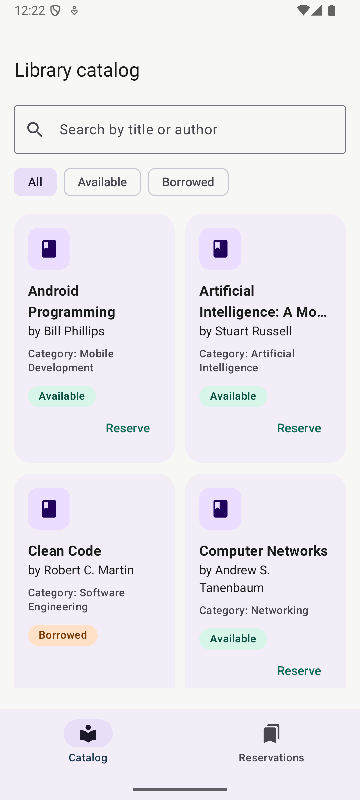
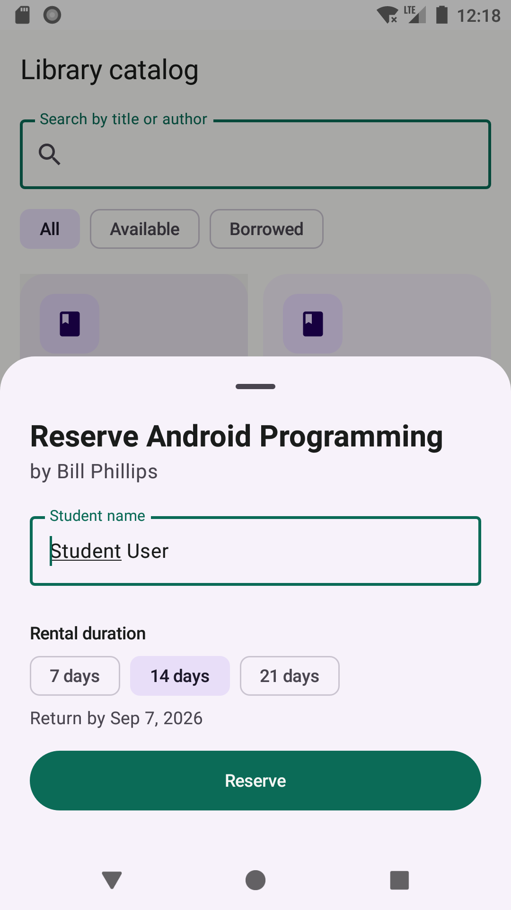
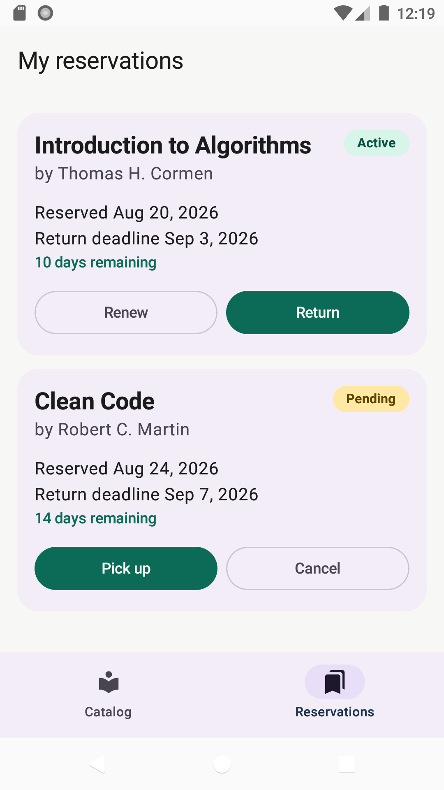

# Kitabu — Library Book Rental & Reservation System

Kitabu is a native, offline-first Android application for browsing a local library catalogue, reserving books, tracking deadlines, and managing reservation lifecycles. It was built for MADB372 Task 1 using Kotlin, Jetpack Compose, Room, MVVM, Coroutines, Flow, and Navigation Compose.

## Core features

- Responsive book catalogue with case-insensitive title/author search and availability filters.
- Availability badges that update reactively from Room.
- Reservation sheet with validated student name and 7, 14, or 21-day rental periods.
- Pending pickup, cancellation, active renewal, and return workflows.
- Atomic Room transactions prevent half-completed lifecycle changes.
- Offline persistence with 12 seeded books and two demonstration bookings.

## Architecture

```text
Compose UI -> ViewModel/StateFlow -> LibraryRepository -> LibraryDao -> Room/SQLite
     ^                                                        |
     +---------------------- Flow updates ---------------------+
```

The project uses a single Activity and one app module. Manual dependency injection keeps the assignment easy to explain while preserving separation between `ui`, `domain`, `data`, and `di` packages.

## Database

- `books`: `book_id`, `title`, `author`, `category`, `is_available`
- `bookings`: `booking_id`, `book_owner_id`, `user_name`, `booking_date`, `return_deadline`, `status`
- `bookings.book_owner_id` references `books.book_id` with cascade deletion.
- `BookingStatus` is stored through a Room type converter.

## Requirements

- Android Studio 2026.1 or compatible
- JDK 17+
- Android SDK 37
- Android device or emulator running API 26+

## Build and test

```bash
./gradlew testDebugUnitTest
./gradlew lintDebug
./gradlew assembleDebug
./gradlew connectedDebugAndroidTest
```

Open the project folder in Android Studio, allow Gradle sync to finish, then run the `app` configuration.

### Verified baseline

The checked-in version was verified on 24 August 2026 with:

- Five JVM unit tests passing.
- Seven connected tests passing on `bkk_api26` (API 26).
- Seven connected tests passing on `medium_phone` (API 36).
- `lintDebug` and `assembleDebug` passing.

The connected suite covers the Room seed, case-insensitive search, joined dashboard rows, reservation rollback/double-reservation protection, foreign-key cascade, lifecycle actions, and the Compose start destination.

## Lifecycle rules

1. Reserve claims an available book and creates a PENDING booking in one transaction.
2. Pick up changes PENDING to ACTIVE.
3. Renew extends an ACTIVE deadline by seven days from the later of today or the existing deadline.
4. Return changes ACTIVE to RETURNED and releases the book in one transaction.
5. Cancel deletes only a PENDING booking and releases the book in one transaction.

Invalid transitions and double reservations are rejected without partial writes.

## Scope and limitation

“Real time” means immediate updates on the same device through Room `Flow`. Cloud synchronization, authentication, payments, Firebase, REST services, and multi-user accounts are intentionally out of scope under the assignment specification.

## Rubric evidence

| Requirement | Implementation/evidence |
| --- | --- |
| Native responsive UI | Compose Material 3 catalogue grid, search, filters, sheet, dashboard, light/dark theme |
| Navigation | Single-activity `NavHost` with Catalog and My Reservations destinations |
| Persistent CRUD | Room entities, DAO, generated schema, seed callback, suspend writes and `Flow` reads |
| Correct lifecycle | Atomic reserve, pickup, renew, return and cancel transactions with guarded transitions |
| Reactive state | Repository flows mapped into immutable ViewModel `StateFlow` and collected lifecycle-aware |
| Validation/accessibility | Trimmed 1–50 character user name, disabled duplicate submission, touch targets, labels and descriptions |
| Verification | JVM, in-memory Room and Compose instrumentation tests on API 26 and API 36 |

## Screenshots and demonstration







The full screenshot sequence is in `docs/screenshots/`, the concise monitor demonstration script is in `docs/MONITOR_DEMO.md`, and the importable design board is in `docs/design/Kitabu_Figma_Import.svg`.

## Submission evidence

Real emulator screenshots and the screenshot document are stored under `docs/`. Replace `<StudName>` in the final document and ZIP names before Canvas submission.
